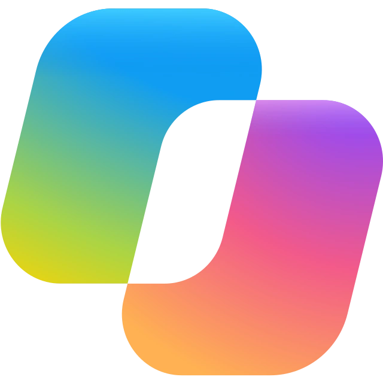

### Hi there, I'm effame 👋

🚀 **Full-Stack & AI Systems Developer** passionate about building clean, high-performance, and scalable software solutions.

---

### 🤖 AI & Coding Assistants

  
  
  

### 💻 Languages & Frameworks

  
  
  

### ☁️ Cloud, Infrastructure & Databases

  
  
  

### 🛠️ Environments, Tools & Design

  

---

⚡ *Pair-programmed and automated with Google Antigravity & AI Agents.*
