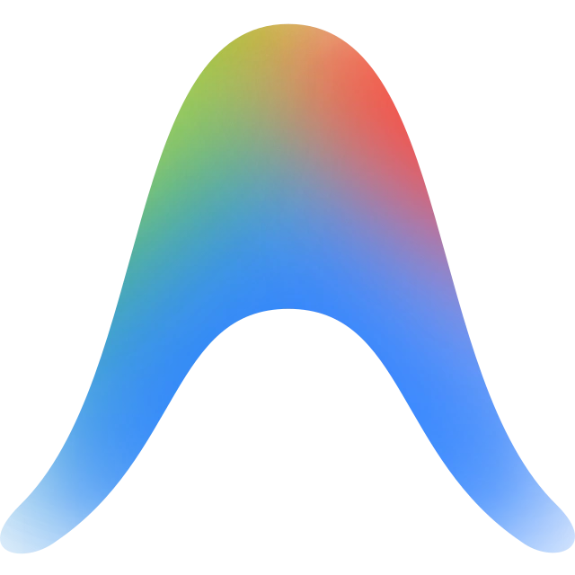
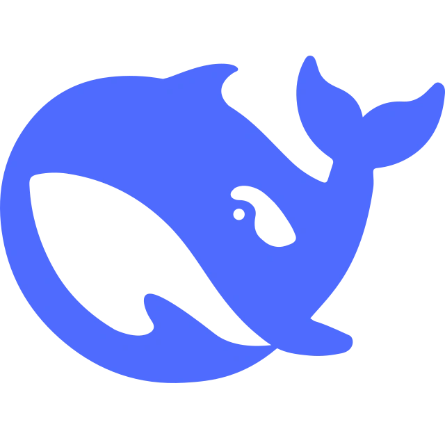

### Hi there, I'm effame 👋

Full-Stack & AI Systems Developer passionate about building clean, high-performance, and scalable software solutions.

🔭 Building scalable Full-Stack & AI-driven applications.

---

### AI & Coding Assistants

  
  
  
  

### Languages & Frameworks

  
  
  
  

### Cloud, Infrastructure & Databases

  
  
  

### Environments, Tools & Design

  

---

### Connect with Me

  
  
  

---

*Pair-programmed and automated with Google Antigravity & AI Agents.*
